This tutorial explains how to launch a GPU-based local model on demand using Auto Deploy on [Glows.ai](https://glows.ai), and connect it to an always-on Open WebUI interface — building a cost-efficient hybrid setup where a CPU instance stays on for the interface while the GPU model only spins up when needed.

This tutorial covers:

- Setting up Auto Deploy for a GPU instance
- Verifying that the local model launched by Auto Deploy is working
- Deploying an Open WebUI instance
- Adding an Auto Deploy connection in Open WebUI
- Testing a real conversation

## Introduction to Auto Deploy

Auto Deploy is an on-demand deployment mechanism provided by Glows.ai: an instance automatically starts when a request arrives, and automatically releases after being idle for a set period. It's well suited for interfaces with unpredictable traffic, since it only occupies expensive GPU resources when inference is actually needed.

Open WebUI itself is a lightweight chat interface that can stay running without a GPU. It forwards conversation requests to an external API — in this case, the GPU model launched by Auto Deploy.

Let's walk through the full setup of this architecture on Glows.ai step by step.

## Set Up Auto Deploy

1. Go to **`Auto Deploy`** in the left sidebar of the Glows.ai platform, then click **`New Deploy`** in the top-right corner.

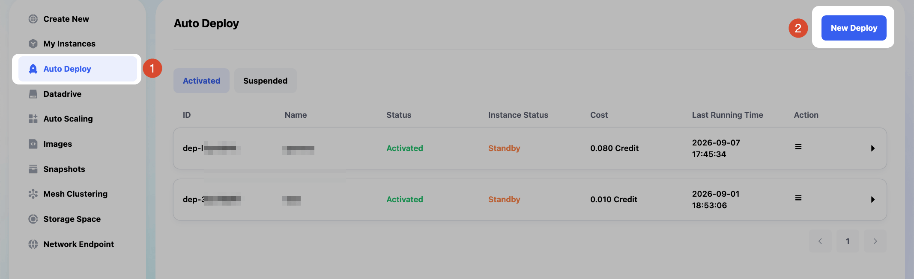

2. Start creating the instance: choose GPU, select **`NVIDIA GeForce RTX 4090`** as the model, and choose an image bundled with the `Gemma4 31B Q4` model.

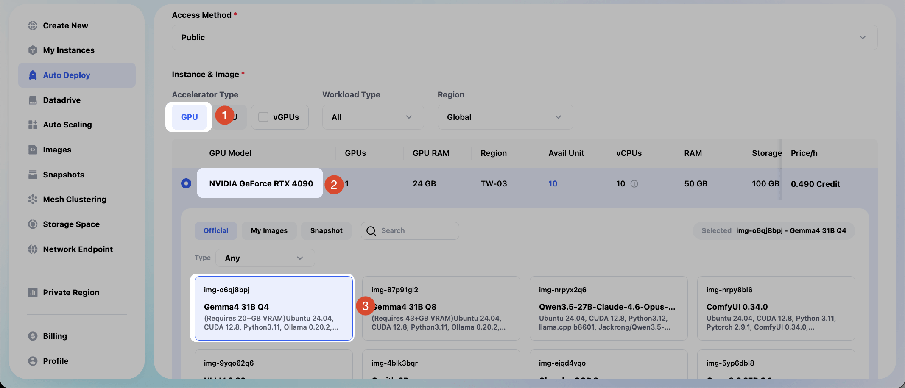

3. Scroll down and enter `11434` in the Port (HTTP/HTTPS) field (this is the default port Ollama listens on). Click `Confirm` to create the Auto Deploy.

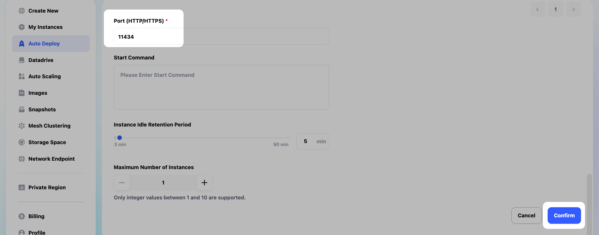

4. In the Auto Deploy interface, click the instance you just created in the list, then expand it to see the fixed public **URL** field. Copy this URL.

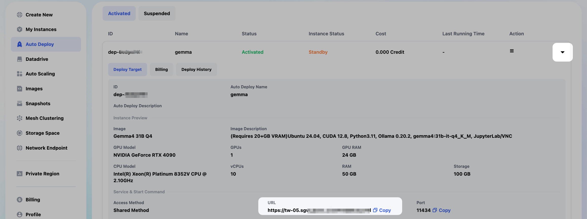

## Test Auto Deploy

1. Before connecting to Open WebUI, it's a good idea to test the API directly from a terminal first, to confirm Auto Deploy is configured correctly.

Test whether the chat feature (Chat Completions API) works correctly from a terminal.

Run:

```json
curl -X POST "your-AutoDeploy-URL/v1/chat/completions" \
  -H "Content-Type: application/json" \
  -d '{
    "model": "gemma4:31b-it-q4_K_M",
    "messages": [{"role": "user", "content": "hello"}]
  }'
```

As shown in the screenshot, this command successfully returns a reply from the local AI model running on the instance launched by Auto Deploy.

> Note: be patient on the first call — sending a request through Auto Deploy is what triggers Glows.ai to start the GPU instance, and startup takes roughly ten to thirty seconds.

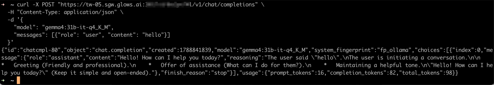

Note: the model name to put in the `model` field is `gemma4:31b-it-q4_K_M` for the image used in this tutorial.

If you're using an instance with a different image than this tutorial, the model name will differ. You can run `curl "your-AutoDeploy-URL/api/tags"` first to get the exact model name.

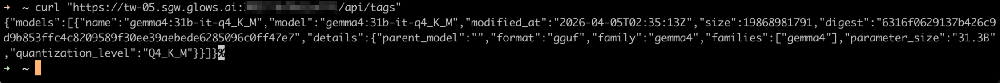

2. In the Glows.ai instance interface, we can see that the instance was successfully started via Auto Deploy as a result of that command.

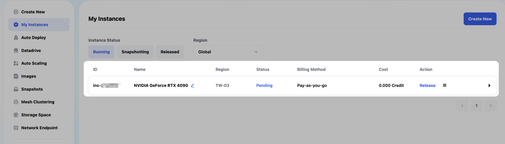

3. Once the instance is running, it will automatically release if no new requests come in. You can set the auto-release delay when creating the Auto Deploy.

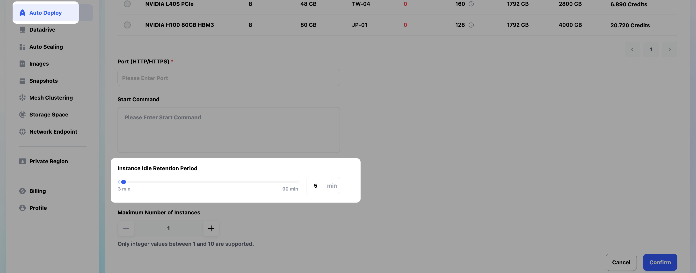

## Set Up the Model Connection in Open WebUI

1. On the instance creation page, create a new instance using an image that includes Open WebUI. You can type `open webui` in the search box to quickly find the Open WebUI image.

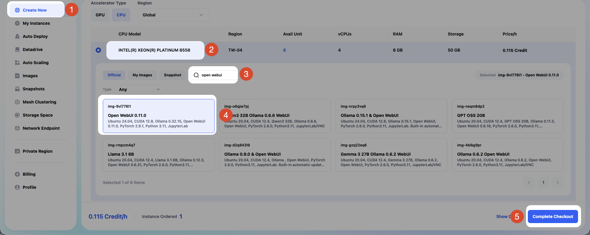

2. Once the instance is running, go to `Access` > `HTTP Port 8080` > `Open` to open the Open WebUI interface.

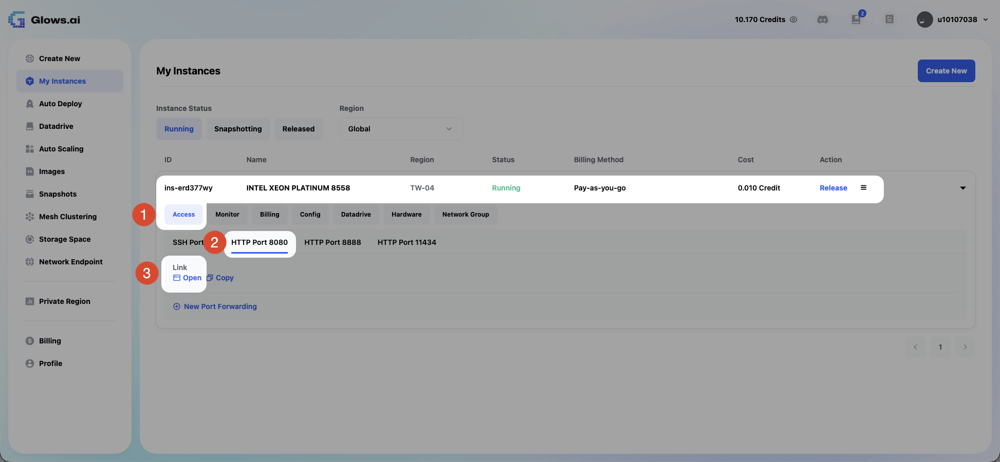

3. In Open WebUI, click `Workspace` > `Models` > `Create` to start creating a model.

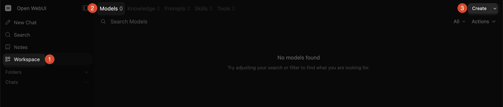

4. After opening the model menu, click `Manage Connections` in the list.

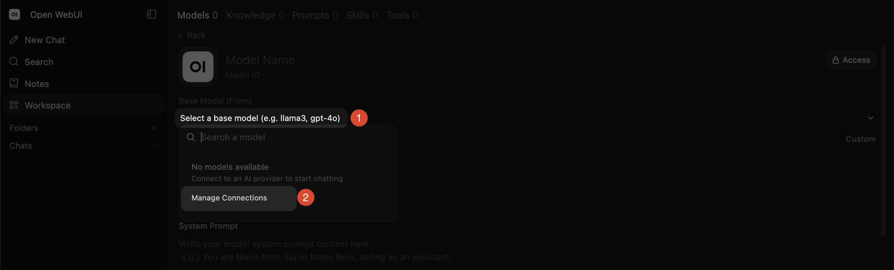

5. A popup will appear — click the `+` on the right to start creating a new connection.

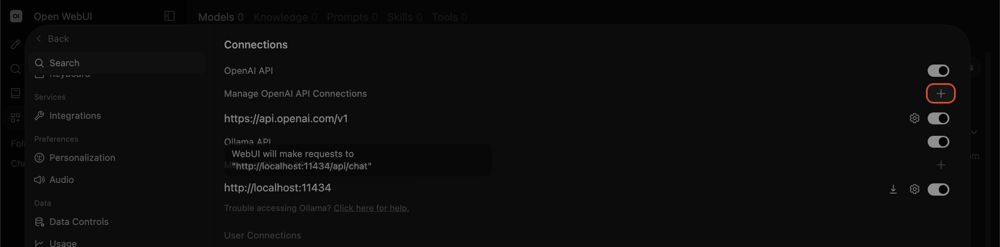

6. In the URL field, paste the URL you copied from the Auto Deploy page earlier, and add `/v1` at the end (for example, `https://tw-05.sgw.glows.ai:0000/x/xxxxxxxx/v1`), then click Save. (You can leave the `Auth` field in the popup blank, since Ollama doesn't require an API key by default.)

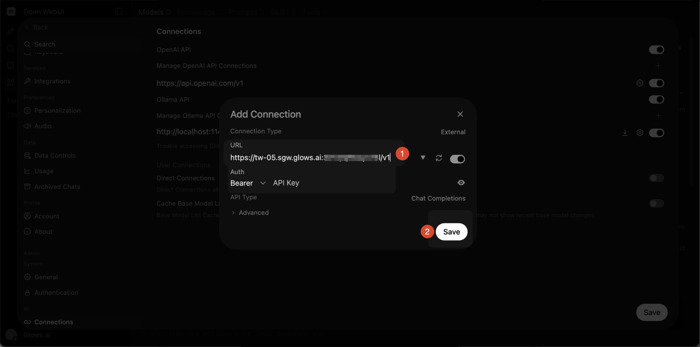

7. Once the popup form is saved successfully, you'll see the new connection you just created in the list. Confirm it, then click `Save`.

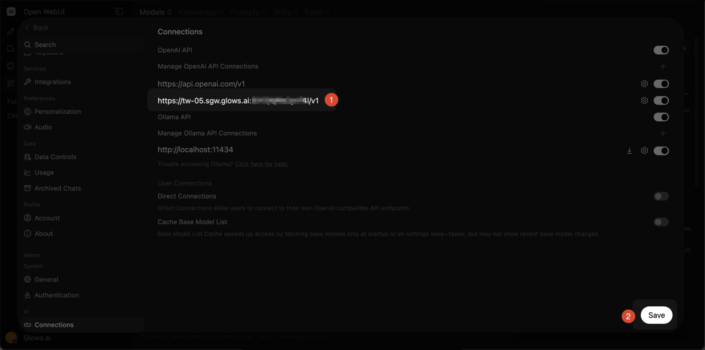

## Start a Conversation

1. Click `New Chat` on the Open WebUI home screen to start a new conversation. Click the model list on the right side of the input box and select the model you just created.

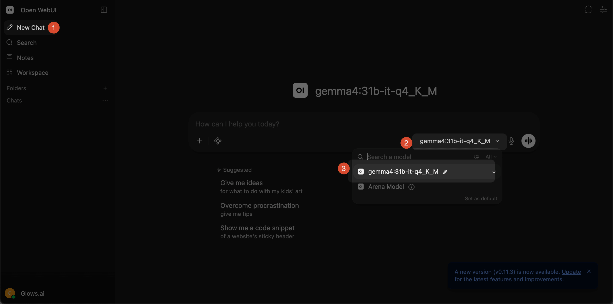

2. This triggers Auto Deploy and successfully returns a reply from the local AI model running on the Glows.ai instance.

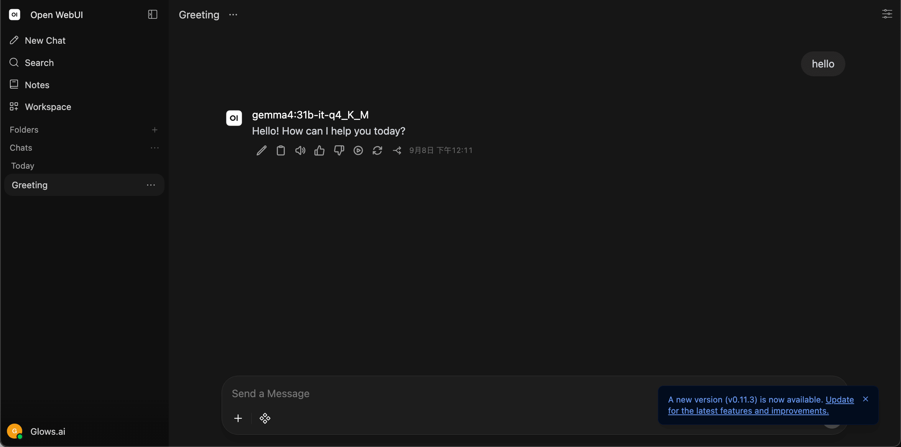

3. A successful model call means the instance started successfully. Once the instance is running, it will automatically release if no new requests come in. You can set the auto-release delay when creating the Auto Deploy.


## Contact Us

If you have any questions or suggestions while using Glows.ai, feel free to contact us via email, Discord, or Line.

**Email:** [support@glows.ai](mailto:support@glows.ai)

**Discord:** [https://discord.com/invite/glowsai](https://discord.com/invite/glowsai)

**Line:** [https://lin.ee/fHcoDgG](https://lin.ee/fHcoDgG)
