このチュートリアルでは、オープンソースツール ai-ml-gpu-bench を使って、[Glows.ai](https://glows.ai) の GPU インスタンス上で複数のオープンソース大規模言語モデル（LLM）を実際に動かし、1 秒あたりに生成できるトークン数を測定する方法を解説します。自動生成されるレポートでは、内蔵されたさまざまなパソコンや GPU の参考データと並べて比較できます。

今回は Glows.ai の NVIDIA GeForce RTX 4090 インスタンスを使用し、テスト全体は約 7 分で完了します。検証の中で、Ollama のバージョンとコンテキスト長の設定が結果に非常に大きく影響することもわかりました。正確で比較可能な数値を得るための設定方法もあわせて説明します。

このチュートリアルの内容は以下のとおりです。

- インスタンスの作成と Ollama の設定
- ai-ml-gpu-bench のインストール
- テストの実行と GPU の使用状況の確認
- レポートの確認と他のマシンとの比較
- 応用：1 つのモデルだけをテストする
- 結果のまとめと活用のヒント

## ai-ml-gpu-bench の紹介

[ai-ml-gpu-bench](https://github.com/albedan/ai-ml-gpu-bench) はオープンソースの AI 性能テストツールです。Ollama を通じて複数のモデルに同じ質問に答えさせ、各モデルを 3 回ずつ実行して生成速度を記録し、最後に HTML レポートを自動で作成します。

レポートの特長は、**さまざまなパソコンの参考データが内蔵されている**ことです。あなたの結果は、他のマシン（RTX 4080 SUPER、RTX 5070 Ti、Apple M4 Pro など）と並べて表示されます。

- **太枠の棒**：今回のテスト結果
- **細枠の棒**：他のマシンの参考データ

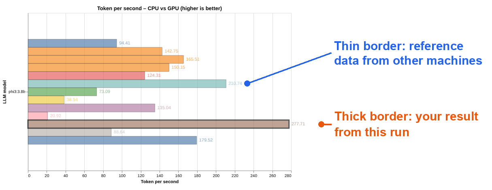

GPU をレンタルする前に、そのマシンでどのモデルが動くかを見積もりたい場合は、別のチュートリアル「llmfit でマシンが動かせる AI モデルを調べる方法」を参照してください。ai-ml-gpu-bench は、実際にモデルを一度動かして本当の速度を測定します。

このチュートリアルで使う用語です。

- **トークン（token）**：モデルが文章を生成するときの基本単位
- **tokens/s**：1 秒あたりに生成されるトークン数。数値が大きいほど回答が速い
- **VRAM**：グラフィックスカード上のメモリ。モデル全体が VRAM に収まらないと全速で動作しない
- **コンテキスト長（Context）**：モデルが一度に処理できる内容の長さ。大きく設定するほど VRAM を多く使う

## 事前準備

- 操作時間は約 20 分（モデルのダウンロードを含む）
- RTX 4090 インスタンスは 0.490 Credit/h で、このチュートリアルの完了には約 0.2 Credit が必要

## パート 1：インスタンスの作成と Ollama の設定

### 1. インスタンスを作成する

`Create New` をクリックして、インスタンスの作成を始めます。

1. GPU Model で **NVIDIA GeForce RTX 4090** を選択します（24GB VRAM、10 vCPUs、50GB RAM、0.490 Credit/h）
2. Official イメージで ollama を検索し、**Ollama 0.32.15**（img-4blkmbpr、Ollama と JupyterLab をプリインストール済み）を選択します
3. `Complete Checkout` をクリックしてインスタンスを作成します

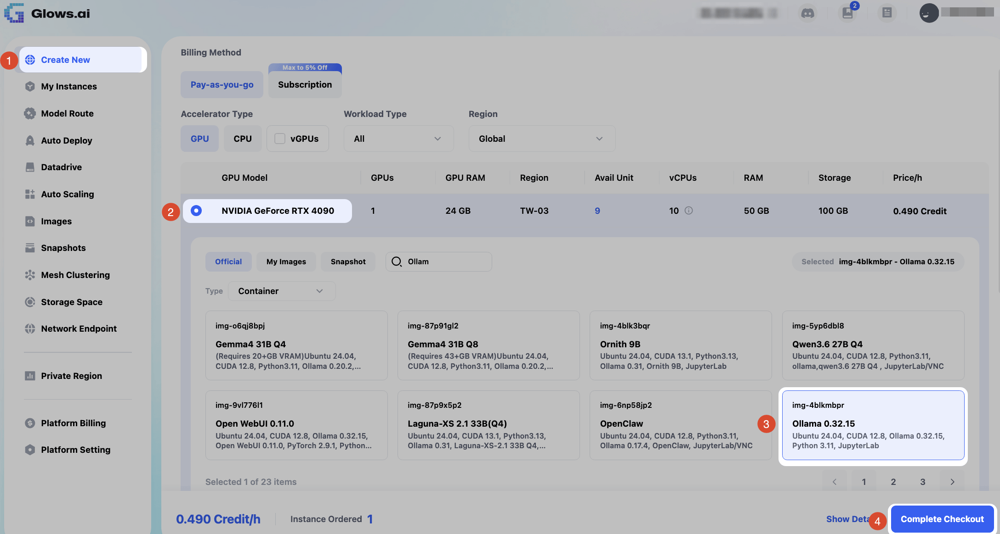

### 2. ターミナルを開く

インスタンスが起動したら、`My Instances` でそのインスタンスの `Access` をクリックし、**HTTP Port 8888** を選択して `Open` をクリックし、JupyterLab を開きます。続けて Terminal をクリックしてターミナルを開きます。このチュートリアルのコマンドはすべてターミナルで実行します。

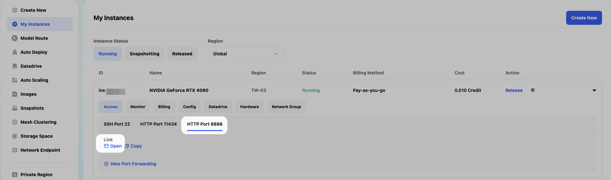

### 3. Ollama 0.24.0 をインストールする

次のコマンドを実行します。

```bash
curl -fsSL https://ollama.com/install.sh | OLLAMA_VERSION=0.24.0 sh
ollama --version
```

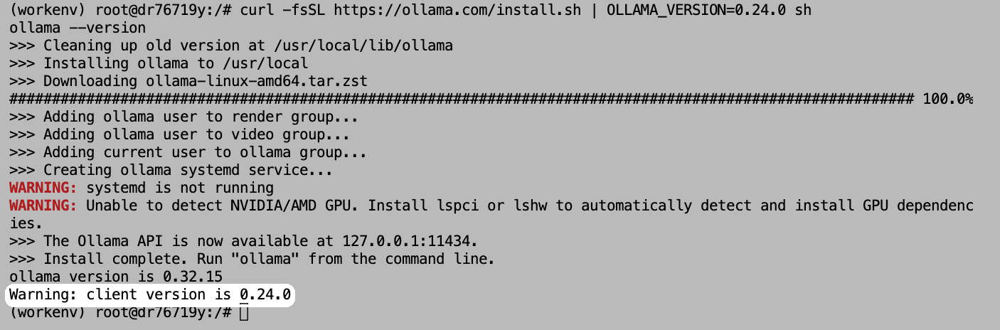

**なぜ Ollama 0.24.0 に切り替えるのか？** レポートに含まれる別の RTX 4090 の参考データは、Ollama 0.24.0 で測定されています。バージョンをそろえれば、比較されるのはハードウェアそのものになります。検証では、イメージにプリインストールされている 0.32.15 の速度は、0.24.0 の 3～4 割ほどしかありませんでした（詳しくは「パート 6：結果のまとめ」を参照）。

画面に表示される 2 つの WARNING は、使用に影響しません。

- **systemd is not running**：クラウドインスタンスには systemd がないため、インストーラーがサービスを自動で起動できません。次のステップで手動で起動します
- **Unable to detect NVIDIA/AMD GPU**：インストーラーに GPU 検出ツールの `lspci` がないためです。GPU 自体は正常に使えます

最後の行に **client version is 0.24.0** と表示されれば、新しいバージョンのインストールは完了です。ただし、バックグラウンドで動いているのは、起動時に立ち上がった古いサービス（0.32.15）のままです。

### 4. Ollama を再起動し、コンテキスト長を 4K に設定する

次のコマンドを実行します。

```bash
pkill ollama
sleep 2
OLLAMA_CONTEXT_LENGTH=4096 nohup ollama serve > /root/ollama.log 2>&1 &
sleep 3
ps aux | grep "ollama serve" | grep -v grep
ollama --version
```

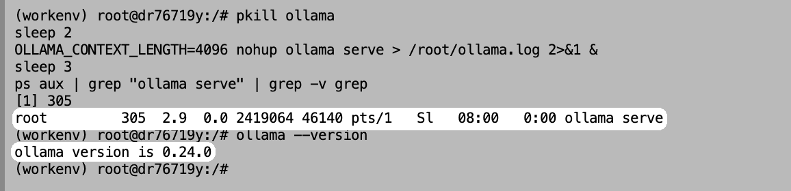

コマンドの説明です。

- `pkill ollama`：古い Ollama サービスを停止します
- `OLLAMA_CONTEXT_LENGTH=4096`：コンテキスト長を 4K に設定し、新しいバージョンで Ollama を再起動します
- `ps aux | grep ...`：Ollama が起動したことを確認します。新しい PID が表示されます
- `ollama --version`：**ollama version is 0.24.0** だけが表示され、Warning が出なければ、切り替え成功です

**なぜ 4K に設定するのか？** このイメージの Ollama は、コンテキスト長がデフォルトで 32K です。一方、ai-ml-gpu-bench はモデルの回答の長さを制限しません。検証では、32K の設定で phi3 が回答を終えられず、画面が Run 1/3 のまま 10 分以上止まりました。4K に変更すると、1 回あたり約 3 秒で終わりました。4K にすることで、毎回のテスト条件もそろえられます。

**注意：** あとで `ollama ps` に CONTEXT 32768 と表示される場合は、設定が反映されていません。このステップのコマンドをもう一度実行してください。

## パート 2：ai-ml-gpu-bench のインストール

### 1. uv をインストールする

uv は Python の管理ツールで、このプロジェクトに必要な Python のバージョンとパッケージを自動で準備します。次のコマンドを実行します。

```bash
curl -LsSf https://astral.sh/uv/install.sh | sh
source $HOME/.local/bin/env
```

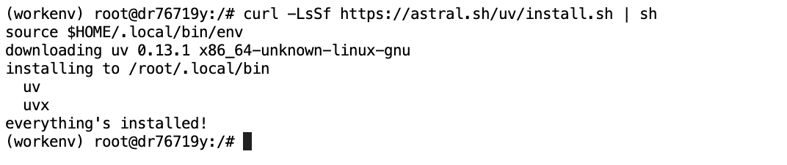

**everything's installed!** と表示されれば、インストールは完了です。

### 2. プロジェクトをダウンロードする

次のコマンドを実行します。

```bash
cd /root
git clone https://github.com/albedan/ai-ml-gpu-bench
cd ai-ml-gpu-bench
```

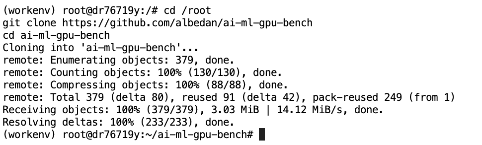

プロジェクトを `/root` の下に置くと、あとで JupyterLab からレポートをダウンロードしやすくなります。

### 3. GPU だけをテストするように設定する

次のコマンドを実行します。

```bash
cd /root/ai-ml-gpu-bench
sed -i 's/gpu_used:    \[true, false\]/gpu_used:    [true]/' ai_bench_suite.yaml
grep gpu_used ai_bench_suite.yaml
```

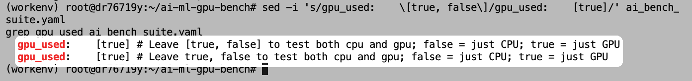

2 行とも **[true]** と表示されれば、設定は完了です。

**なぜ GPU だけをテストするのか？** ツールはデフォルトで、各モデルを GPU と CPU でそれぞれ 3 回ずつ実行します。クラウドインスタンスでの CPU テストは非常に遅く、検証では 1 つのモデルの 1 回の実行だけで 10 分以上かかり、すべて終わるには数時間が必要でした。レポートには他のマシンの CPU データが数多く含まれているため、CPU と GPU の差はそれを参照できます。

**注意：** 新しく開いたターミナルのタブで実行する場合、開始位置はルートディレクトリ（`/`）です。必ず先に `cd /root/ai-ml-gpu-bench` を実行してください。実行しないと No such file or directory というエラーになります。

## パート 3：テストの実行

### 1. テストを開始する

次のコマンドを実行します。

```bash
uv run run_suite.py --suite ollama --fast --autopull --no-upload-results
```

パラメーターの説明です。

| パラメーター | 説明 |
|---|---|
| `--suite ollama` | LLM のテストだけを実行し、もう 1 つの XGBoost 機械学習テストはスキップします |
| `--fast` | 小さな 4 つのモデル（phi3:3.8b、gemma4:e2b、qwen3:4b、deepseek-r1:8b）だけをテストします |
| `--autopull` | 足りないモデルを自動でダウンロードします |
| `--no-upload-results` | テスト結果をローカルにだけ保存します。ツールはデフォルトで、結果を暗号化して作者のサーバーにアップロードします |

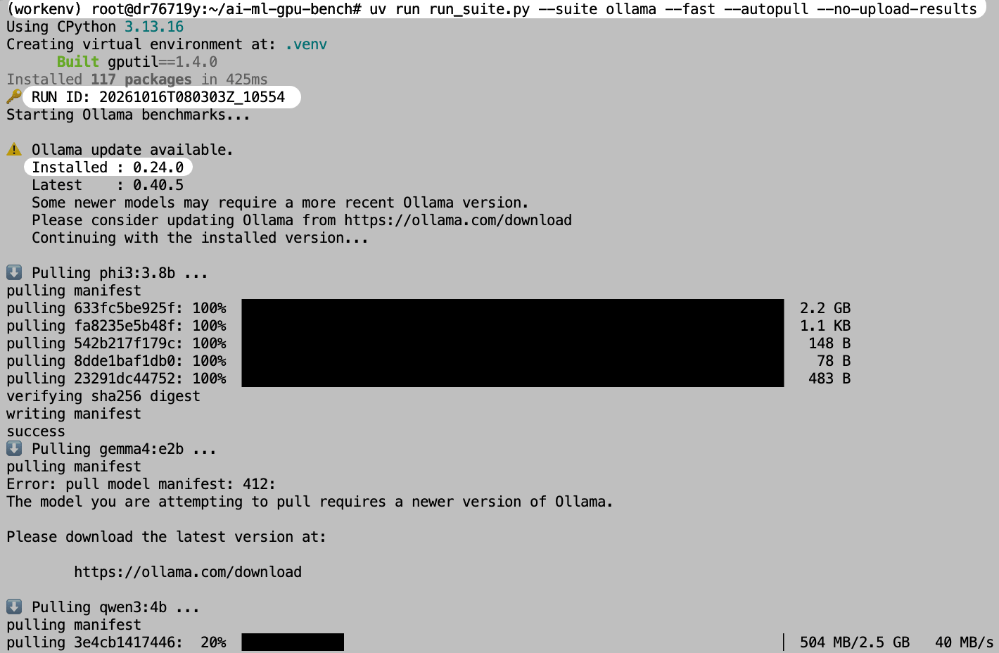

画面には、次の内容が順に表示されます。

- uv による Python 環境の自動作成（初回は時間がかかります）
- **RUN ID**：今回のテストの番号
- **Installed : 0.24.0**：テストに使う Ollama のバージョンの確認です。下の update available は新しいバージョンがあるという通知で、テストには影響しません
- モデルの自動ダウンロード

gemma4:e2b のダウンロード時には **412** エラーが表示されます。Gemma 4 にはより新しい Ollama が必要で、0.24.0 はまだ対応していないためです。ツールがこのモデルを自動でスキップするので、残りの 3 つのモデルのテストには影響しません。

### 2. 1 つのモデルの結果を確認する

各モデルは同じ質問で 3 回テストされます（質問はイタリア語で、「ラクダとヒトコブラクダの違いを説明してください」という内容です）。完了すると結果の表が表示されます。qwen3:4b を例に見てみましょう。

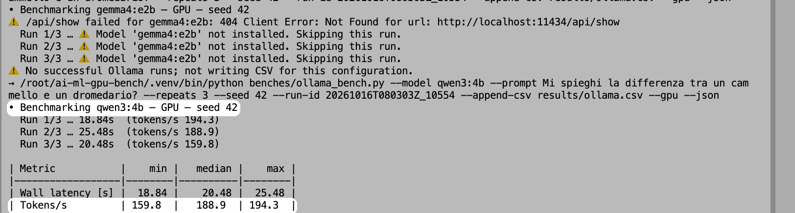

- **Wall latency [s]**：1 回の回答にかかった合計秒数
- **Tokens/s**：1 秒あたりに生成されたトークン数。3 回の中央値（median）を結果とします

qwen3:4b の中央値は **188.9 tokens/s** です。qwen3 と deepseek-r1 は「考えて」から回答するため、生成するトークンが多く、1 回の回答に約 20 秒かかります。一方、phi3 は約 3 秒です。

画面上部の gemma4:e2b には not installed. Skipping this run と表示されています。前のステップでダウンロードに失敗したためスキップされました。

各表の下には、JSON 形式の詳細データも出力されます。注目すべき項目は次のとおりです。

- **"context_length": 4096**：コンテキスト長 4K の設定が反映されています
- **"vram_residency_pct": 100.0**：モデルが 100% GPU 上で動作しています

### 3. モデルが GPU に完全に読み込まれていることを確認する

テスト中またはテスト完了後に、別のターミナルタブを開いて次のコマンドを実行します。

```bash
ollama ps
```

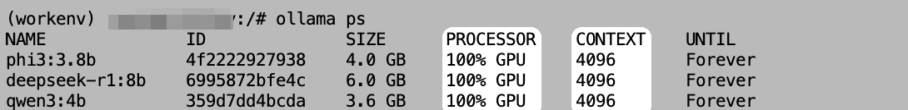

- **PROCESSOR**：すべて **100% GPU** で、モデルは VRAM に完全に読み込まれ、CPU には振り分けられていません
- **CONTEXT**：すべて **4096** で、先ほどの設定と一致しています
- **UNTIL**：Forever は、実行後も自動でアンロードされず、VRAM に残り続けることを示します

### 4. GPU の使用状況を確認する

別のターミナルタブを開いて、次のコマンドを実行します。

```bash
watch -n 1 nvidia-smi
```

`watch -n 1` は 1 秒ごとに画面を更新するという意味です。`Ctrl + C` で終了します。テストがすでに終わっている場合は、別のタブで次のコマンドを実行して、モデルに質問に答えさせます。

```bash
ollama run qwen3:4b "Explain what a GPU is in about 300 words."
```

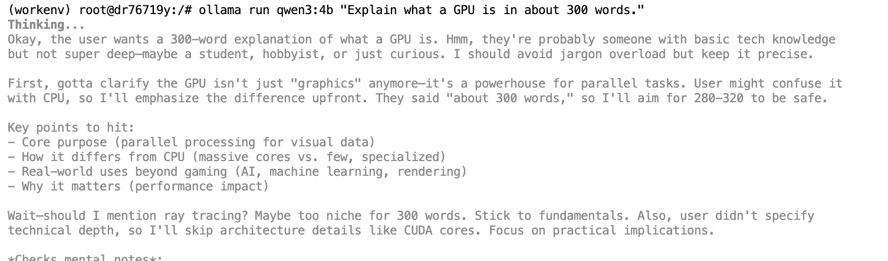

モデルの待機中と演算中の比較です。

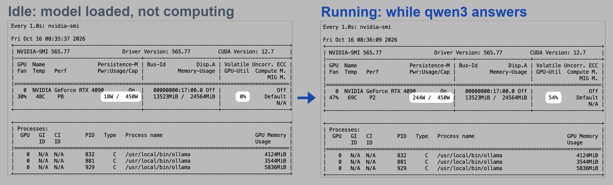

| 項目 | 待機中（モデル読み込み済み） | 演算中 |
|---|---|---|
| GPU-Util | 0% | **54%** |
| 消費電力 | 18W | **244W** |
| 温度 | 48°C | **69°C** |

どちらの画面もメモリ使用量は約 13.5GB です。3 つのモデルがすべて VRAM に残っているためです。GPU-Util が 100% にならないのは異常ではありません。4B クラスの小さなモデルは、RTX 4090 にとっては負荷が小さいためです。性能を評価するときは、やはり tokens/s を基準にしてください。

### 5. テスト完了

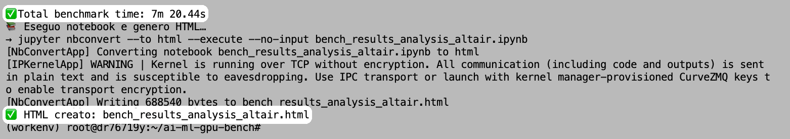

テスト全体は約 **7 分 20 秒**で完了します。最後に **HTML creato**（イタリア語で「HTML を作成しました」）と表示されれば、レポートが生成されています。

## パート 4：テストレポートの確認

### 1. レポートをダウンロードする

レポートのファイルは `/root/ai-ml-gpu-bench/bench_results_analysis_altair.html` にあります。クラウドインスタンスには画面がないため、レポートは自動では開きません。自分のパソコンにダウンロードして開く必要があります。

JupyterLab の左側のファイル一覧で、`root` → `ai-ml-gpu-bench` の順にクリックし、`bench_results_analysis_altair.html` を右クリックして `Download` を選択します。

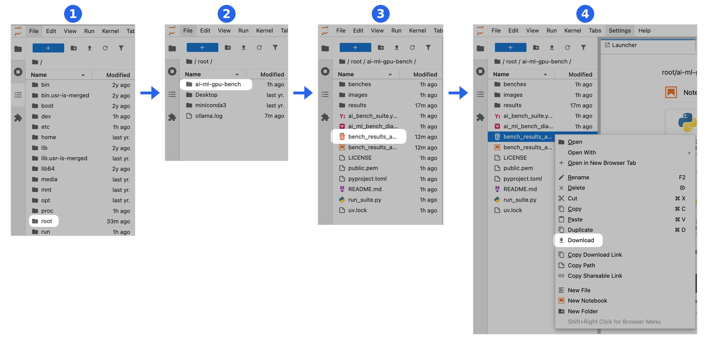

### 2. レポートの概要

ブラウザーでレポートを開くと、一番上に今回のテストの概要があります。

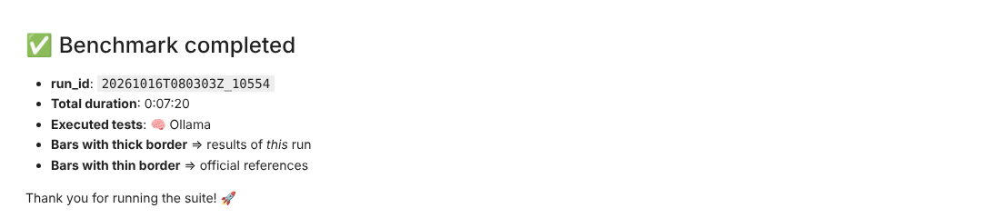

レポートには続いて 2 つのグラフがあります。

- **Training time**：XGBoost 機械学習テストの結果です。今回はこのテストを実行していないため、グラフには他のマシンのデータしかありません。読み飛ばして構いません
- **Token per second**：LLM テストの結果で、今回の主役です

Token per second のグラフには、すべてのマシンとモデルが含まれているため、数が非常に多くなっています。グラフの下にあるフィルターメニューで、比較したい項目だけを表示できます。

### 3. 他の RTX 4090 と比較する

フィルター条件：**GPU** は NVIDIA GeForce RTX 4090、**GPU used** は GPU を選択します。

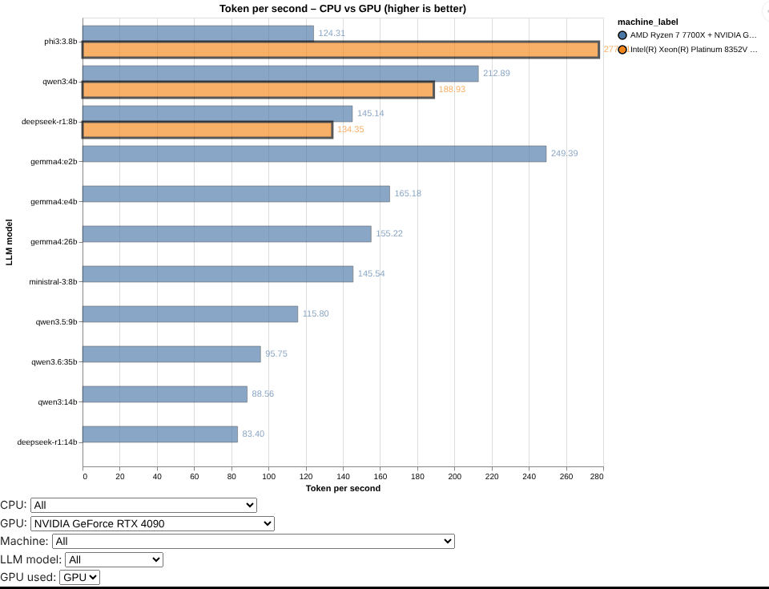

オレンジの太枠が今回の Glows.ai インスタンスです（凡例には Intel(R) Xeon(R) Platinum 8352V と表示されていますが、これはインスタンスの CPU の型番です）。青の細枠は、レポートにある別の RTX 4090 の参考データ（AMD Ryzen 7 7700X + RTX 4090、同じく Ollama 0.24.0 を使用）です。phi3 の値は 277.71 です。

| モデル | Glows.ai RTX 4090 | 参考データ RTX 4090 |
|---|---|---|
| phi3:3.8b | **277.71** | 124.31 |
| qwen3:4b | 188.93 | 212.89 |
| deepseek-r1:8b | 134.35 | 145.14 |

（単位：tokens/s）

qwen3 と deepseek-r1 は参考データの約 9 割で、phi3 は 2 倍以上速くなっています。全体としては同じ水準です。

### 4. 他のマシンと比較する：phi3

フィルター条件：**LLM model** は phi3:3.8b、**GPU used** は GPU を選択します。

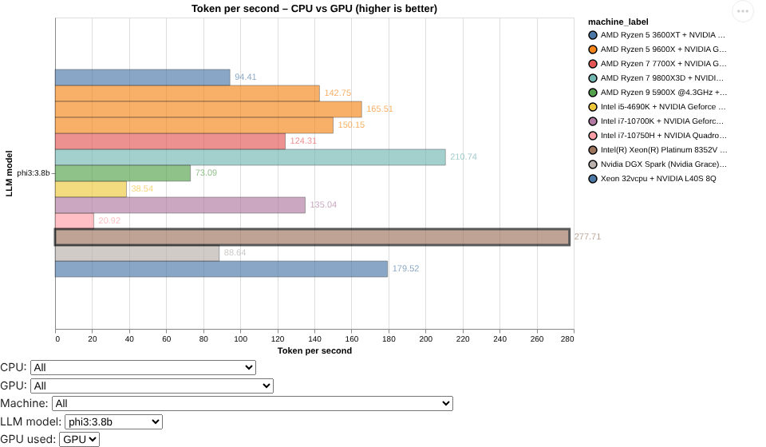

太枠の茶色の棒（Intel(R) Xeon(R) Platinum 8352V）が、今回の Glows.ai RTX 4090 です。phi3 の GPU データをアップロードしたすべてのマシンの中で、**277.71 tokens/s が最速**で、2 位の RTX 4080 SUPER（210.74）を上回っています。

**注意：** マシンによって、使用している Ollama のバージョンや設定が同じとは限りません。たとえば今回はコンテキスト長を 4K にしているため、数値の差がそのままハードウェアの差を表すわけではありません。

## パート 5：応用：1 つのモデルだけをテストする

特定の 1 つのモデルだけをテストしたい場合は、テスト全体を実行する必要はありません。phi3 を例に、次のコマンドを実行します。

```bash
cd /root/ai-ml-gpu-bench
.venv/bin/python benches/ollama_bench.py --model phi3:3.8b --prompt "Mi spieghi la differenza tra un cammello e un dromedario?" --repeats 3 --seed 42 --gpu
```

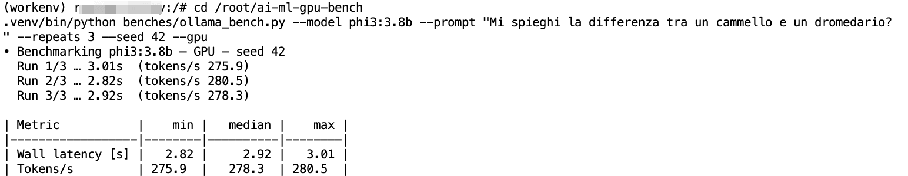

約 10 秒で完了し、結果は **278.3 tokens/s** でした。テスト全体の 277.7 との差は 1% 未満で、結果がかなり安定していることがわかります。この方法ではテスト結果は書き込まれず、すでに生成されたレポートも変更されません。`--model` の後ろを、ダウンロード済みの別のモデル名に置き換えることもできます。

## パート 6：結果のまとめ

### 1. 実測結果

| モデル | 生成速度（tokens/s） | 1 回の回答時間 | VRAM への読み込み |
|---|---|---|---|
| phi3:3.8b | **277.71** | 3.01 秒 | 100% GPU |
| qwen3:4b | **188.93** | 20.48 秒 | 100% GPU |
| deepseek-r1:8b | **134.35** | 11.85 秒 | 100% GPU |
| gemma4:e2b | —（Ollama 0.24.0 は未対応） | — | — |

テスト環境：Glows.ai RTX 4090 インスタンス、Ollama 0.24.0、コンテキスト長 4K。数値はすべて 3 回のテストの中央値です。

### 2. Ollama のバージョンによる影響

検証の途中で、Ollama 0.32.15 で同じテストを実行したところ、速度は明らかに遅くなりました。

| モデル | Ollama 0.32.15 | Ollama 0.24.0 | 差 |
|---|---|---|---|
| phi3:3.8b | 81.70 | **277.71** | 3.4 倍 |
| qwen3:4b | 62.46 | **188.93** | 3.0 倍 |
| deepseek-r1:8b | 52.73 | **134.35** | 2.5 倍 |

（単位：tokens/s。どちらも同じスペックの RTX 4090 インスタンスで、コンテキスト長 4K でテストしました）

2 回のテストのレポートを並べて比較します（フィルター条件はどちらも GPU：NVIDIA GeForce RTX 4090、GPU used：GPU）。左の図は 0.32.15 を使ったもので、オレンジの太枠がすべて青の参考データより短くなっています。右の図は 0.24.0 に切り替えたあとで、速度は参考データと同程度です。

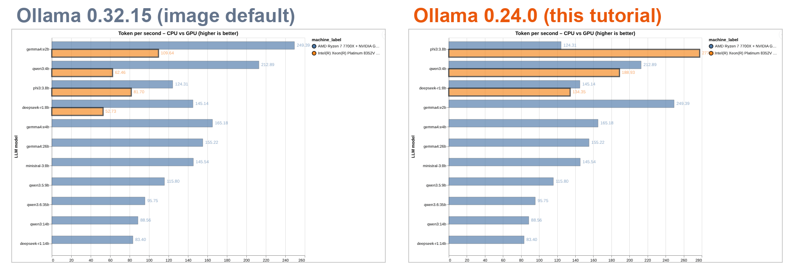

同じ GPU でも、Ollama のバージョンが違うだけで速度に 2.5～3.4 倍の差が出ました。他のマシンと比較するときは、まず双方の Ollama のバージョンが同じかどうかを確認してください。そうしないと、比較されるのはハードウェアではなくソフトウェアのバージョンになってしまいます。

### 3. 活用のヒント

1. **まず Ollama のバージョンを確認する**：数値を比較する前に `ollama --version` でバージョンを確認します。参考データのバージョンと同じであって初めて公平な比較になります
2. **コンテキスト長を固定する**：`OLLAMA_CONTEXT_LENGTH` でコンテキスト長を設定し、デフォルト値が大きすぎてモデルが止まらなくなるのを防ぎます
3. **最初は GPU だけをテストする**：クラウドインスタンスでの CPU テストは極端に遅いので、レポートにある他のマシンの CPU データを参照します
4. **tokens/s を基準にする**：GPU-Util は高ければ良いわけではありません。小さなモデルが RTX 4090 の性能を使い切れないのは正常です

## お問い合わせ

Glows.ai の利用中に質問やご意見がある場合は、email、Discord、Line からお問い合わせください。

**Email:** [support@glows.ai](mailto:support@glows.ai)

**Discord:** [https://discord.com/invite/glowsai](https://discord.com/invite/glowsai)

**Line:** [https://lin.ee/fHcoDgG](https://lin.ee/fHcoDgG)
