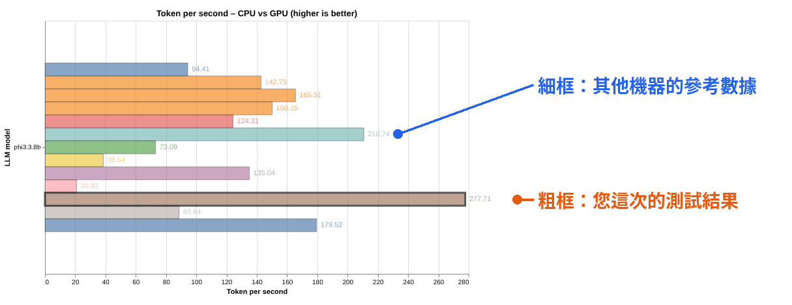
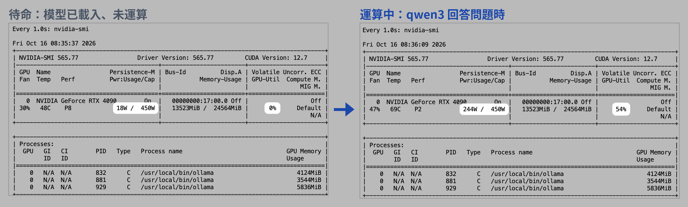
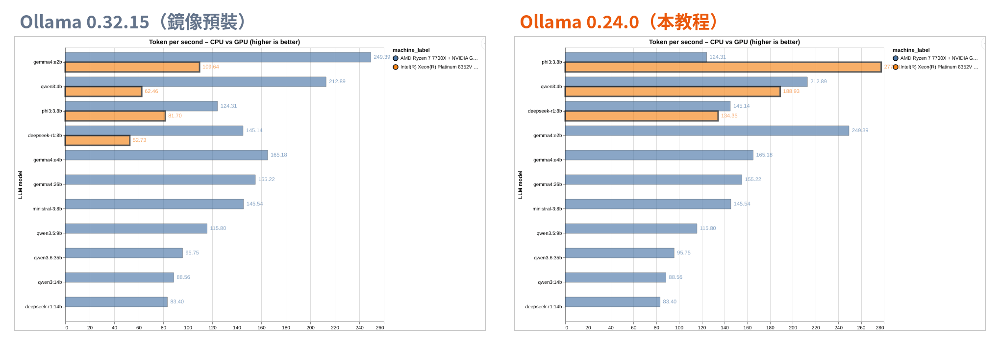

本教程說明如何使用開源工具 ai-ml-gpu-bench，在 [Glows.ai](https://glows.ai) 的 GPU 實例上實際執行多個開源大型語言模型（LLM），測出每秒能生成多少 token，並在自動產生的報告中，與報告內建的各種電腦、顯卡參考數據並排比較。

本次使用 Glows.ai 的 NVIDIA GeForce RTX 4090 實例，整套測試約 7 分鐘即可完成。實測過程中也發現，Ollama 的版本與對話長度設定，對測試結果影響非常大，本教程會一併說明如何設定，才能得到準確、可比較的數據。

本教程包括以下內容：

- 建立實例並設定 Ollama
- 安裝 ai-ml-gpu-bench
- 執行測試並觀察 GPU 使用狀況
- 查看測試報告，與其他機器比較
- 進階：單獨測試一個模型
- 結果總整理與使用建議

## ai-ml-gpu-bench 簡介

[ai-ml-gpu-bench](https://github.com/albedan/ai-ml-gpu-bench) 是一個開源的 AI 效能測試工具。它會透過 Ollama 讓多個模型回答同一個問題，每個模型重複執行 3 次，記錄生成速度，最後自動產生一份 HTML 報告。

報告的特色是**內建各種電腦的參考數據**，您的結果會與各種電腦（例如 RTX 4080 SUPER、RTX 5070 Ti、Apple M4 Pro 等）並排顯示：

- **粗框長條**：您這次的測試結果
- **細框長條**：其他機器的參考數據



若您想在租用 GPU 之前，先預估某台機器能執行哪些模型，可參考另一篇教學「用 llmfit 評估機器能跑哪些 AI 模型」；ai-ml-gpu-bench 則是實際執行一次，測出真實速度。

本教程會用到的名詞：

- **token**：模型生成文字的基本單位
- **tokens/s**：每秒生成的 token 數，數字越大代表回答越快
- **VRAM**：顯示卡上的記憶體，模型需要完整放進 VRAM 才能全速執行
- **對話長度（Context）**：模型一次能處理的內容長度，設定越大，佔用的 VRAM 越多

## 前置準備

- 約 20 分鐘的操作時間（含模型下載）
- RTX 4090 實例為 0.490 Credit/h，完成本教程約需 0.2 Credit

## 一、建立實例並設定 Ollama

### 1. 建立實例

點擊 `Create New` 後開始建立實例：

1. GPU Model 選擇 **NVIDIA GeForce RTX 4090**（24GB VRAM、10 vCPUs、50GB RAM，0.490 Credit/h）
2. 於 Official 鏡像中搜尋 ollama，選擇 **Ollama 0.32.15**（img-4blkmbpr，已預裝 Ollama 與 JupyterLab）
3. 點擊 `Complete Checkout` 建立實例


### 2. 開啟終端機

實例成功運行後，於 `My Instances` 點擊該實例的 `Access`，選擇 **HTTP Port 8888**，點擊 `Open` 開啟 JupyterLab，再點擊 Terminal 開啟終端機。本教程所有指令皆在終端機中執行。


### 3. 安裝 Ollama 0.24.0

執行：

```bash
curl -fsSL https://ollama.com/install.sh | OLLAMA_VERSION=0.24.0 sh
ollama --version
```


**為什麼要改用 Ollama 0.24.0？** 報告中另一台 RTX 4090 的參考數據使用 Ollama 0.24.0。版本相同，比較的才是硬體本身。實測時，鏡像預裝的 0.32.15 速度只有 0.24.0 的三到四成（詳見「六、結果總整理」）。

畫面中的兩個 WARNING 不影響使用：

- **systemd is not running**：雲端實例沒有 systemd，安裝程式無法自動啟動服務，下一步會手動啟動
- **Unable to detect NVIDIA/AMD GPU**：安裝程式缺少偵測 GPU 的工具 `lspci`，GPU 本身可正常使用

最後一行顯示 **client version is 0.24.0**，代表新版已安裝完成，但背景執行的仍是開機時啟動的舊版服務（0.32.15）。

### 4. 重新啟動 Ollama，並將對話長度設為 4K

執行：

```bash
pkill ollama
sleep 2
OLLAMA_CONTEXT_LENGTH=4096 nohup ollama serve > /root/ollama.log 2>&1 &
sleep 3
ps aux | grep "ollama serve" | grep -v grep
ollama --version
```


指令說明：

- `pkill ollama`：關閉舊版的 Ollama 服務
- `OLLAMA_CONTEXT_LENGTH=4096`：將對話長度設為 4K，並以新版重新啟動 Ollama
- `ps aux | grep ...`：確認 Ollama 已啟動，畫面會出現一個新的 PID
- `ollama --version`：只顯示 **ollama version is 0.24.0**、沒有 Warning，代表換版成功

**為什麼要設為 4K？** 此鏡像的 Ollama 預設對話長度為 32K，而 ai-ml-gpu-bench 不會限制模型的回答長度。實測時，phi3 在 32K 設定下一直無法結束回答，畫面停在 Run 1/3 超過 10 分鐘；改為 4K 後，每次只需約 3 秒。設為 4K 也能讓每次測試的條件一致。

**注意：** 若之後 `ollama ps` 仍顯示 CONTEXT 32768，代表設定沒有生效，請重新執行本步驟的指令。

## 二、安裝 ai-ml-gpu-bench

### 1. 安裝 uv

uv 是 Python 的管理工具，會自動準備此專案需要的 Python 版本與套件。執行：

```bash
curl -LsSf https://astral.sh/uv/install.sh | sh
source $HOME/.local/bin/env
```


出現 **everything's installed!** 即安裝完成。

### 2. 下載專案

執行：

```bash
cd /root
git clone https://github.com/albedan/ai-ml-gpu-bench
cd ai-ml-gpu-bench
```


專案放在 `/root` 底下，之後較容易從 JupyterLab 下載報告。

### 3. 設定只測試 GPU

執行：

```bash
cd /root/ai-ml-gpu-bench
sed -i 's/gpu_used:    \[true, false\]/gpu_used:    [true]/' ai_bench_suite.yaml
grep gpu_used ai_bench_suite.yaml
```


兩行皆顯示 **[true]** 即設定完成。

**為什麼只測 GPU？** 工具預設會將每個模型分別以 GPU 與 CPU 各執行 3 次。CPU 測試在雲端實例上非常緩慢，實測單一模型的單次執行就超過 10 分鐘，全部跑完需要數小時。報告中已有大量其他機器的 CPU 數據，可直接參考 CPU 與 GPU 的差距。

**注意：** 若在新開的終端機分頁執行，起始位置為根目錄（`/`），請務必先執行 `cd /root/ai-ml-gpu-bench`，否則會出現 No such file or directory。

## 三、執行測試

### 1. 開始測試

執行：

```bash
uv run run_suite.py --suite ollama --fast --autopull --no-upload-results
```

參數說明：

| 參數 | 說明 |
|---|---|
| `--suite ollama` | 只執行 LLM 測試，跳過另一項 XGBoost 機器學習測試 |
| `--fast` | 只測試 4 個小模型：phi3:3.8b、gemma4:e2b、qwen3:4b、deepseek-r1:8b |
| `--autopull` | 自動下載缺少的模型 |
| `--no-upload-results` | 測試結果只存在本機。工具預設會將結果加密上傳至作者的伺服器 |


畫面依序顯示：

- uv 自動建立 Python 環境（第一次執行較久）
- **RUN ID**：此次測試的編號
- **Installed : 0.24.0**：確認測試使用的 Ollama 版本。下方的 update available 為提醒有新版本，不影響測試
- 自動下載模型

gemma4:e2b 下載時出現 **412** 錯誤：Gemma 4 需要較新版的 Ollama，0.24.0 尚未支援，工具會自動跳過此模型，不影響其他 3 個模型的測試。

### 2. 查看單一模型的結果

每個模型會以同一個問題測試 3 次（問題為義大利文，內容是「請解釋駱駝與單峰駱駝的差別」），完成後顯示結果表格。以 qwen3:4b 為例：


- **Wall latency [s]**：回答一次問題花費的總秒數
- **Tokens/s**：每秒生成的 token 數，取 3 次中的中位數（median）作為結果

qwen3:4b 的中位數為 **188.9 tokens/s**。qwen3 與 deepseek-r1 會先「思考」再回答，生成的 token 較多，所以單次回答需要約 20 秒，phi3 則只需約 3 秒。

畫面上方的 gemma4:e2b 顯示 not installed. Skipping this run，即前一步下載失敗而被跳過。

每個表格下方還會輸出一段 JSON 格式的詳細數據，其中值得留意的是：

- **"context_length": 4096**：對話長度 4K 的設定已生效
- **"vram_residency_pct": 100.0**：模型 100% 載入 GPU 執行

### 3. 確認模型完整載入 GPU

測試進行中或完成後，另開一個終端機分頁，執行：

```bash
ollama ps
```


- **PROCESSOR**：皆為 **100% GPU**，模型完整載入 VRAM，沒有分給 CPU 運算
- **CONTEXT**：皆為 **4096**，與先前設定相符
- **UNTIL**：Forever 代表模型執行完不會自動卸載，會持續留在 VRAM 中

### 4. 觀察 GPU 使用狀況

另開一個終端機分頁，執行：

```bash
watch -n 1 nvidia-smi
```

`watch -n 1` 代表每 1 秒更新一次畫面，按 `Ctrl + C` 離開。若測試已經結束，可在另一個分頁執行以下指令，讓模型回答一個問題：

```bash
ollama run qwen3:4b "Explain what a GPU is in about 300 words."
```


模型待命與運算中的對比：



| 項目 | 待命（模型已載入） | 運算中 |
|---|---|---|
| GPU-Util | 0% | **54%** |
| 功耗 | 18W | **244W** |
| 溫度 | 48°C | **69°C** |

兩個畫面的記憶體用量皆為約 13.5GB，因為 3 個模型都留在 VRAM 中。GPU-Util 沒有到 100% 並非異常，4B 等級的小模型對 RTX 4090 而言負擔不大，評估效能時仍以 tokens/s 為準。

### 5. 測試完成


整套測試約 **7 分 20 秒**完成，最後顯示 **HTML creato**（義大利文的「HTML 已建立」）即代表報告已產生。

## 四、查看測試報告

### 1. 下載報告

報告檔案位於 `/root/ai-ml-gpu-bench/bench_results_analysis_altair.html`。雲端實例沒有畫面，報告不會自動開啟，需下載到自己的電腦開啟。

在 JupyterLab 左側的檔案列表中，依序點擊 `root` → `ai-ml-gpu-bench`，於 `bench_results_analysis_altair.html` 按右鍵，選擇 `Download`：


### 2. 報告摘要

以瀏覽器開啟報告，最上方為此次測試的摘要：


報告接著有兩張圖表：

- **Training time**：XGBoost 機器學習測試的結果。本次未執行此項測試，圖表中只有其他機器的數據，可略過
- **Token per second**：LLM 測試的結果，為本次的重點

Token per second 圖表包含所有機器與模型，數量非常多。可使用圖表下方的篩選選單，只顯示需要比較的項目。

### 3. 與其他 RTX 4090 比較

篩選條件：**GPU** 選擇 NVIDIA GeForce RTX 4090、**GPU used** 選擇 GPU。


橘色粗框為本次的 Glows.ai 實例（圖例顯示為 Intel(R) Xeon(R) Platinum 8352V，即實例的 CPU 型號），藍色細框為報告中另一台 RTX 4090 的參考數據（AMD Ryzen 7 7700X + RTX 4090，同樣使用 Ollama 0.24.0）。phi3 的數值為 277.71：

| 模型 | Glows.ai RTX 4090 | 參考數據 RTX 4090 |
|---|---|---|
| phi3:3.8b | **277.71** | 124.31 |
| qwen3:4b | 188.93 | 212.89 |
| deepseek-r1:8b | 134.35 | 145.14 |

（單位：tokens/s）

qwen3 與 deepseek-r1 約為參考數據的九成，phi3 則快了一倍以上，整體為同一水準。

### 4. 與其他機器比較：phi3

篩選條件：**LLM model** 選擇 phi3:3.8b、**GPU used** 選擇 GPU。


粗框的棕色長條（Intel(R) Xeon(R) Platinum 8352V）即為本次的 Glows.ai RTX 4090。在所有上傳 phi3 GPU 數據的機器中，**277.71 tokens/s 為最快**，高於第二名的 RTX 4080 SUPER（210.74）。

**注意：** 各機器使用的 Ollama 版本與設定不一定相同，例如本次將對話長度設為 4K，數字差距不完全代表硬體差異。

## 五、進階：單獨測試一個模型

若只想測試某一個模型，不需要執行整套測試。以 phi3 為例，執行：

```bash
cd /root/ai-ml-gpu-bench
.venv/bin/python benches/ollama_bench.py --model phi3:3.8b --prompt "Mi spieghi la differenza tra un cammello e un dromedario?" --repeats 3 --seed 42 --gpu
```


約 10 秒即可完成，結果為 **278.3 tokens/s**，與整套測試的 277.7 相差不到 1%，代表測試結果相當穩定。此方式不會寫入測試結果，也不會改動已產生的報告。可將 `--model` 後方換成其他已下載的模型名稱。

## 六、結果總整理

### 1. 實測結果

| 模型 | 生成速度（tokens/s） | 單次回答時間 | VRAM 載入 |
|---|---|---|---|
| phi3:3.8b | **277.71** | 3.01 秒 | 100% GPU |
| qwen3:4b | **188.93** | 20.48 秒 | 100% GPU |
| deepseek-r1:8b | **134.35** | 11.85 秒 | 100% GPU |
| gemma4:e2b | —（Ollama 0.24.0 不支援） | — | — |

測試環境：Glows.ai RTX 4090 實例、Ollama 0.24.0、對話長度 4K，數值皆為 3 次測試的中位數。

### 2. Ollama 版本的影響

實測過程中，曾以 Ollama 0.32.15 執行同一套測試，速度明顯較慢：

| 模型 | Ollama 0.32.15 | Ollama 0.24.0 | 差距 |
|---|---|---|---|
| phi3:3.8b | 81.70 | **277.71** | 3.4 倍 |
| qwen3:4b | 62.46 | **188.93** | 3.0 倍 |
| deepseek-r1:8b | 52.73 | **134.35** | 2.5 倍 |

（單位：tokens/s，兩次皆於同規格的 RTX 4090 實例、對話長度 4K 下測試）

兩次測試的報告並排比較（篩選條件皆為 GPU：NVIDIA GeForce RTX 4090、GPU used：GPU）。左圖使用 0.32.15，橘色粗框全部短於藍色的參考數據；右圖換成 0.24.0 後，速度與參考數據相當：



同樣的 GPU，只因 Ollama 版本不同，速度就差了 2.5 至 3.4 倍。與其他機器比較時，請先確認雙方使用的 Ollama 版本是否相同，否則比較的不是硬體，而是軟體版本。

### 3. 使用建議

1. **先確認 Ollama 版本**：比較數據前，先用 `ollama --version` 確認版本，與參考數據的版本一致才公平
2. **固定對話長度**：使用 `OLLAMA_CONTEXT_LENGTH` 設定對話長度，避免模型因預設值過大而停不下來
3. **先只測 GPU**：CPU 測試在雲端實例上極為緩慢，可直接參考報告中其他機器的 CPU 數據
4. **以 tokens/s 為準**：GPU-Util 不是越高越好，小模型用不滿 RTX 4090 的算力屬於正常

## 聯絡我們

使用 Glows.ai 時若有問題或建議，可透過 email、Discord 或 Line 聯絡我們。

**Email:** [support@glows.ai](mailto:support@glows.ai)

**Discord:** [https://discord.com/invite/glowsai](https://discord.com/invite/glowsai)

**Line:** [https://lin.ee/fHcoDgG](https://lin.ee/fHcoDgG)
